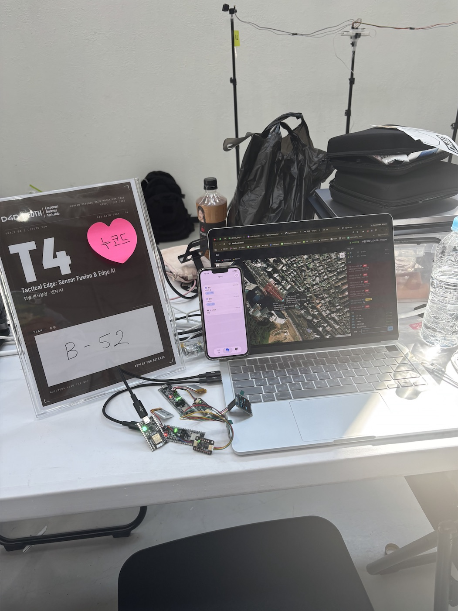
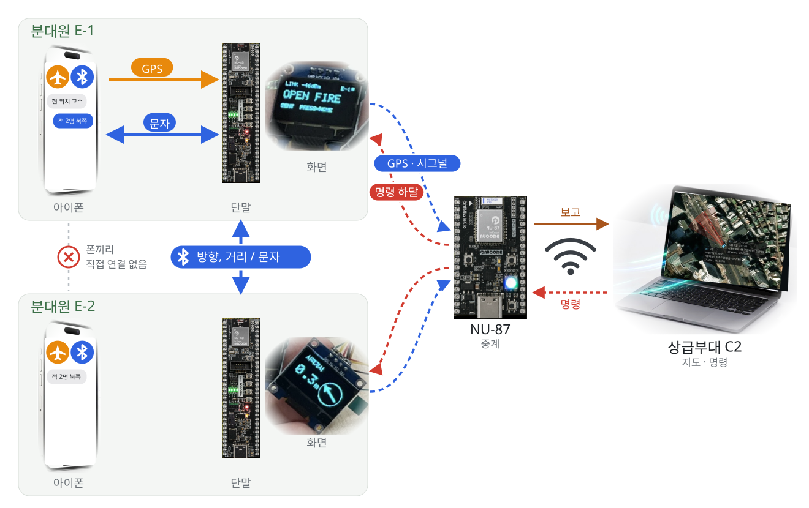
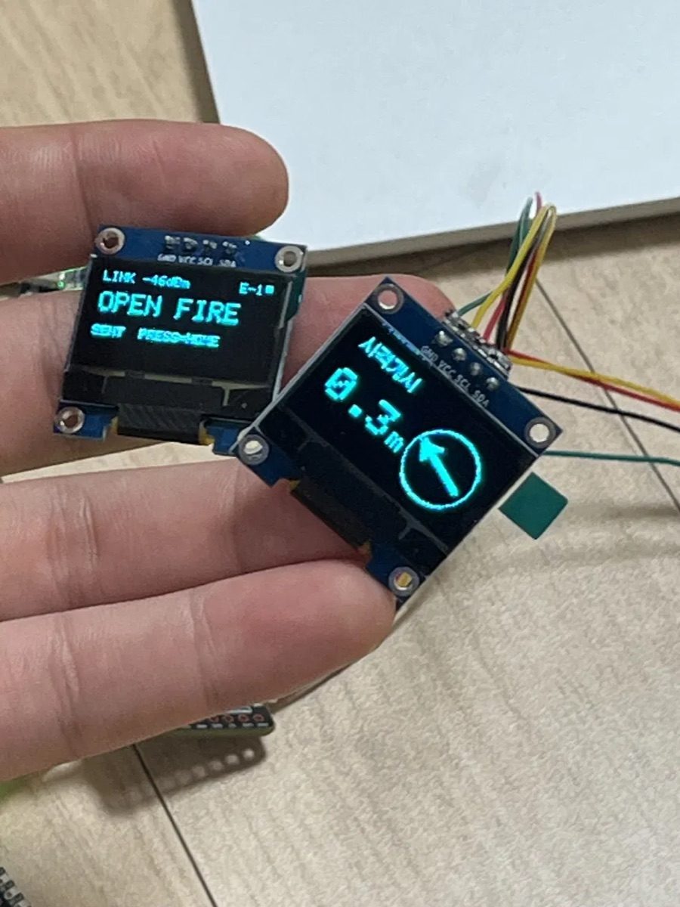
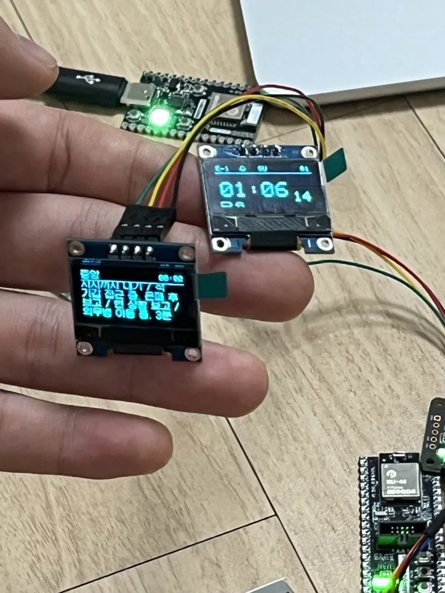
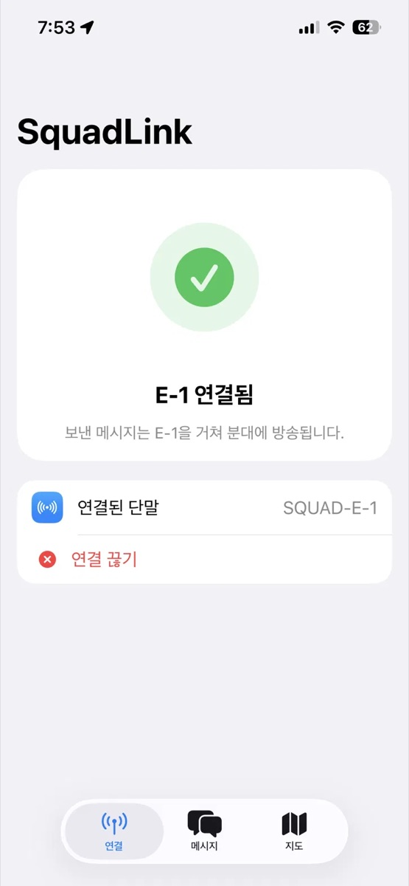
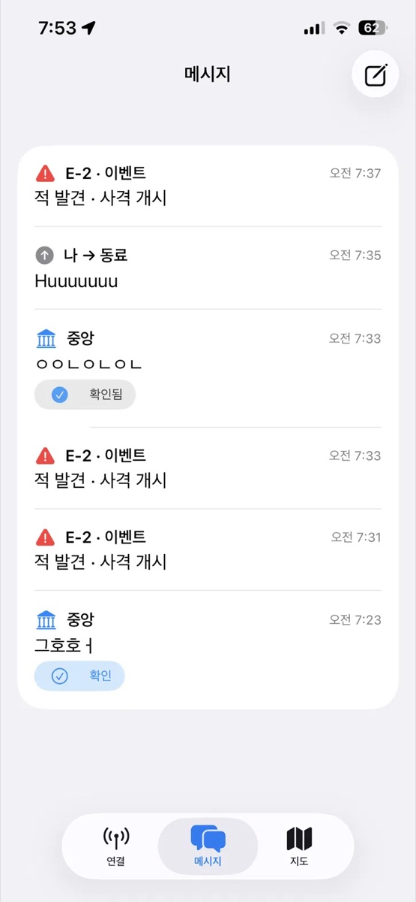
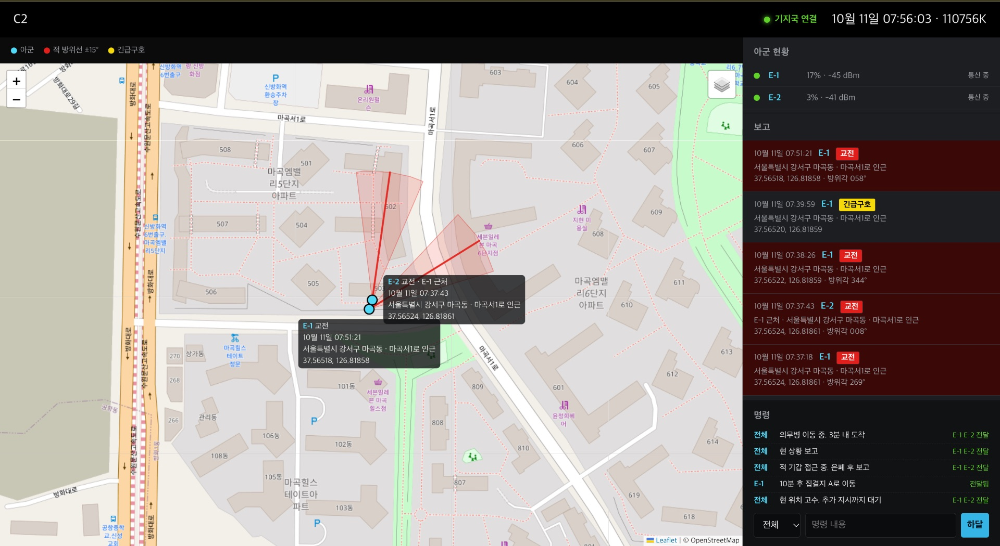

# 현맥

**"3시 방향 적 발견" 대신 진북 기준 적 방향을 공유하고, 필요할 때만 상급부대와 통신하는 분대 C2입니다.**

2026년 10월 10일 열린 **KOREAN DEFENSE TECH HACKATHON | D4D x EDTH**에서 만들었습니다.  
두 트랙에 참가했고, **SC2 — NUCODE Board Challenge에서 2등**을 했습니다.

- **T4 — Tactical Edge: Sensor Fusion & Edge AI**  
  소부대 오프라인 전술 C2와 공통상황도. 상급 망 없이 휴대 단말과 저전력 무선만으로 분대의 위치, 표적, 보고를 공유하는 과제입니다.
- **SC2 — NUCODE Board Challenge**  
  NUCODE 무선 개발보드로 실제로 동작하는 국방 프로토타입을 만드는 과제입니다. 단말 2대는 NU-40, 게이트웨이는 NU-87로 만들었습니다.

## 문제와 해결

**1. "3시 방향"은 외친 사람 기준입니다.**  
듣는 사람이 다른 쪽을 보고 있으면 적이 어디 있는지 모릅니다.  
→ 적을 겨누고 격발하면 진북 기준 방위가 공유됩니다. 분대원 화면의 화살표는 몸을 돌려도 계속 적을 가리킵니다. 해커톤에서는 버튼으로 격발을 대신했습니다.

**2. 적을 발견해도 바로 쏘면 안 될 때가 있습니다.**  
→ 사격개시와 사격금지를 버튼으로 구분해 소리 없이 전파합니다.

**3. 무전기는 분대장만 가지고 있습니다.**  
고장 나면 분대 통신이 끊깁니다.  
→ 모든 분대원이 각자 단말로 상급부대와 연결됩니다.

**4. 인터넷에 접속하면 위치가 드러납니다.**  
→ 교전 상황 전파와 긴급구호 요청 때만 접속합니다. 상급부대의 명령도 바로 내려가지 않고, 분대가 먼저 송신할 때 대기열에 있던 명령이 함께 내려옵니다.

**5. 근거리 무선은 도청, 위조, 재생 공격에 약합니다.**  
→ AES-128 암호화, CBC-MAC 위조 방지, 재생 방지 카운터, 6자리 번호 페어링을 실제로 적용했습니다.

**6. 손목 단말에 GPS, 지도, 키보드까지 넣으면 크고 무겁고 배터리가 빨리 닳습니다.**  
→ 병사가 이미 가진 스마트폰을 씁니다. 폰이 블루투스로 단말에 GPS 위치를 넣어 주고, 메시지 작성과 지도를 맡습니다. 작전 중 폰은 비행기 모드에 블루투스만 켭니다.

## 신호 흐름

## 단말

 

왼쪽은 E-1이 사격개시를 보내고 E-2 화면에 적 방향 화살표가 뜬 모습, 오른쪽은 C2 명령을 받은 화면입니다.

## 앱

 

단말과 연결하고, 분대 이벤트와 C2 명령을 받고, 메시지를 보냅니다.

## C2

교전과 긴급구호 보고가 지도에 뜨고, 적 방위선이 그려집니다. 명령은 대기열에 쌓였다가 분대가 송신할 때 전달됩니다.

## 레포

| 레포 | 내용 |
|---|---|
| [firmware](https://github.com/hyeonmaek/firmware) | 단말(NU-40)과 게이트웨이(NU-87) 펌웨어 |
| [app](https://github.com/hyeonmaek/app) | 아이폰 앱 |
| [web](https://github.com/hyeonmaek/web) | C2 지휘 화면 |
